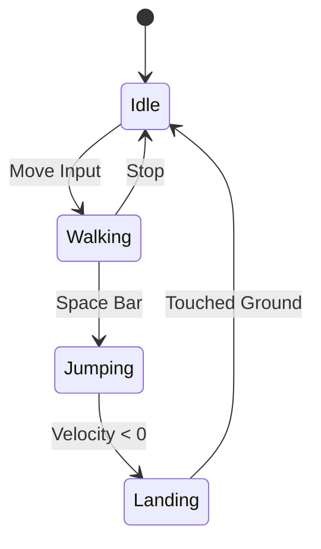
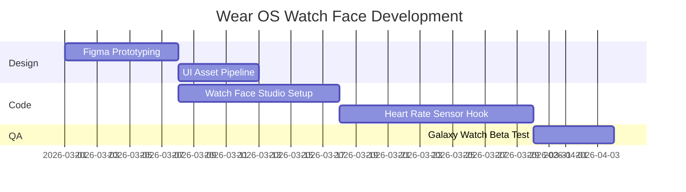
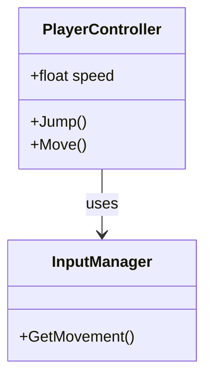

Tworzenie wysokiej jakości treści technicznych wymaga nie tylko jasnego stylu pisania, ale także solidnych narzędzi wizualizacji. W tym kompleksowym przeglądzie przyglądamy się bliżej możliwościom wtyczki `jekyll-spaceship`, zintegrowanej bezpośrednio z naszym systemem projektowym **Hub Architecture**.

To nie tylko pokaz składni — to demonstracja tego, jak niezależny deweloper może tworzyć dokumentację nowej generacji i interaktywne lekcje bez ciężkich, zbędnych zależności.

---

## 1. Zaawansowane tworzenie tabel

Tabele stanowią kręgosłup dokumentacji technicznej. Dzięki `jekyll-spaceship` możemy teraz budować złożone struktury tabelaryczne, które wcześniej wymagały pisania czystego kodu HTML.

### Złożone scalanie komórek (Rowspan i Colspan)

Oto tabela bilansu energetycznego oddychania komórkowego demonstrująca zarówno pionowe, jak i poziome scalanie komórek:

| Etap oddychania komórkowego | Produkty pośrednie | Zysk ATP |
| :-------------------------: | :----------------: | :------: | --- |
| Glikoliza                   | 2 ATP              |          |
| ^^                          | 2 NADH             | 3--5 ATP |
| Utlenianie pirogronianu     | 2 NADH             | 5 ATP    |
| Cykl Krebsa                 | 2 ATP              |          |
| ^^                          | 6 NADH             | 15 ATP   |
| ^^                          | 2 FADH             | 3 ATP    |
| **Łączny zysk netto**       | **30--32 ATP**     |          |     |

### Tekst wielowierszowy w komórkach

Czasami opisy parametrów nie mieszczą się w jednej linii. Znak `\` na końcu wiersza pozwala na płynne kontynuowanie tekstu:

| Parametr            | Wartość | Opis                                                                 |
| :------------------ | :------ | :------------------------------------------------------------------- |
| **Render Scale**    | `1.0x`  | Określa bazową rozdzielczość renderowania głównej klatki obrazu. \   |
|                     |         | Obniżenie tej wartości zwiększa płynność na urządzeniach mobilnych \ |
|                     |         | kosztem ostrości tekstur.                                            |
| **Post-Processing** | `ACES`  | Wykorzystuje system Academy Color Encoding System dla uzyskania \    |
|                     |         | filmowej tonacji obrazu.                                             |

### Tabele bez nagłówków (układy szachownicy i siatki)

W kartach Bento nagłówki tabel są często zbędne. Oto przykład szachownicy 8x8:

|--|--|--|--|--|--|--|--|
|♜| |♝|♛|♚|♝|♞|♜|
| |♟|♟|♟| |♟|♟|♟|
|♟| |♞| | | | | |
| |♗| | |♟| | | |
| | | | |♙| | | |
| | | | | |♘| | |
|♙|♙|♙|♙| |♙|♙|♙|
|♖|♘|♗|♕|♔| | |♖|

---

## 2. Matematyka dla twórców gier (MathJax)

Podczas dokumentowania logiki shaderów, symulacji fizyki czy projekcji kamery precyzja matematyczna jest niezbędna. Obsługujemy pełną notację LaTeX dzięki MathJax.

### Równanie renderowania

Używaj pojedynczych znaków dolara dla wzorów w tekście: $L_o(p, \omega_o) = L_e(p, \omega_o) + \int_{\Omega} f_r(p, \omega_i, \omega_o) L_i(p, \omega_i) (n \cdot \omega_i) d\omega_i$.

Dla wyróżnionych wzorów blokowych używaj podwójnych znaków dolara:

$$
E = mc^2
$$

Lub ciągłych rozkładów prawdopodobieństwa, takich jak **rozkład normalny Gaussa**:

$$
f(x | \mu, \sigma^2) = \frac{1}{\sqrt{2\pi\sigma^2}} e^{-\frac{(x-\mu)^2}{2\sigma^2}}
$$

---

## 3. Zaawansowane diagramy (Mermaid)

Wektorowa wizualizacja architektury w czasie rzeczywistym, bez rastrowych artefaktów PNG.

### Maszyna stanów postaci

Kluczowa dla przejrzystych przejść między stanami kontrolera postaci w Unity:



### Wykres Gantta (Harmonogram produkcji)

Planowanie cyklu wydawniczego tarczy zegarka dla Wear OS:



### Diagram klas



---

## 4. Integracja multimediów

Osadzanie responsywnych multimediów bez zewnętrznych zależności i ciężkich frameworków JS:

### YouTube (Filmy instruktażowe)


### Spotify (Ścieżki dźwiękowe)


---

## 5. Polyfille i Emoji

Listy numerowane z niestandardowymi krokami formatują się bez problemu:

\1. Krok pierwszy (jawne 1) \
\3. Krok drugi (jawne 3)

Natywne emoji w stylu GitHub działają w treści: Uwielbiam tę konfigurację :rocket:! Emoji ładują się czysto z obsługą mechanizmu zapasowego.

---

## 6. Hybrydowy HTML i specyfika kart Bento

Gdy standardowy układ Markdown nie wystarcza, niestandardowy HTML z osadzonym Markdownem jest dostępny przez `<script type="text/markdown">`.

<div class="banner--translation-warning">
  💡 **Uwaga:** Możesz łączyć zaawansowane układy CSS Grid z treścią w Markdownie. Pozwala to tworzyć unikalne siatki Bento, w których każda karta stanowi niezależny komponent techniczny.
</div>

---

## 7. Testowanie przycisku kopiowania kodu

Bloki kodu zawierają automatyczny przycisk kopiowania. Przetestuj go na tym skrypcie Unity C#:

```csharp
using UnityEngine;

// Ultimate code copy button validation
public class CopyTest : MonoBehaviour
{
    [SerializeField] private string message = "Code copied successfully! 🚀";

    void Start()
    {
        Debug.Log(message);
    }
}
```

Ta interakcja jest obsługiwana przez lekki kod Vanilla JS w pliku `script.js` i jest zgodna z wytycznymi Hub Architecture.

---

## Podsumowanie

To stanowi kompletną integrację techniczną. Nasz blog działa jako lekka i wydajna platforma do publikacji technicznych. Łącząc **Vanilla CSS**, **szablony Liquid** oraz możliwości **jekyll-spaceship**, uzyskujemy bogate formatowanie bez utraty szybkości ładowania strony — Mermaid i MathJax ładują się wyłącznie na stronach, które faktycznie ich wymagają.

**Naprzód ku budowaniu małych światów na małe ekrany!** 🎮✨
