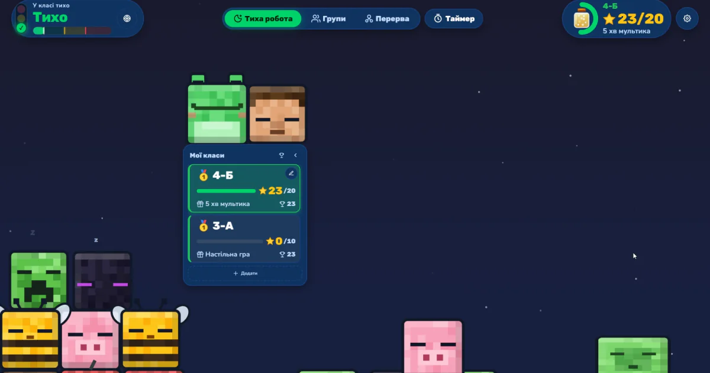

Gdy w klasie robi się głośno, ciągłe upominanie męczy zarówno nauczyciela, jak i uczniów. [Quiet Class (Bouncy)](https://sivochka.com/bouncy/) to darmowy przeglądarkowy miernik hałasu zaprojektowany z myślą o szkolnych telewizorach, projektorach i tablicach interaktywnych. Nie wymaga rejestracji ani instalacji, a po pierwszej wizycie działa także offline.

## Minutowa konfiguracja przed dzwonkiem

Potrzebujesz wyłącznie komputera z przeglądarką i dowolnego podłączonego mikrofonu.

1. Otwórz [sivochka.com/bouncy/](https://sivochka.com/bouncy/) na komputerze podłączonym do tablicy, projektora lub telewizora.
2. Kliknij **Start Lesson** i zezwól na dostęp do mikrofonu na pasku przeglądarki.
3. Wybierz swoją klasę w oknie listy klas albo dodaj nową.
4. Poproś klasę o trzy sekundy ciszy i naciśnij przycisk celownika ◎ obok sygnalizatora, aby skalibrować bazowy poziom hałasu w sali.
5. Naciśnij **F**, aby włączyć tryb pełnoekranowy.

Jeśli na tablicę świeci słońce albo projektor ma słabszy kontrast, włącz w ustawieniach tryb Light room. Możesz też zainstalować aplikację na pulpicie, aby otwierała się we własnym oknie bez wpisywania adresu za każdym razem.

## Jak Quiet Class działa w trzech trybach i w karcie w tle

Surowość miernika zmienisz jednym kliknięciem u góry ekranu lub klawiszami 1, 2 i 3.

| Tryb | Najlepszy do | Reakcja na dźwięk i gwiazdki |
|---|---|---|
| Cicha praca (1) | Praca samodzielna, sprawdziany, czytanie | Najbardziej restrykcyjny: reaguje nawet na głośniejszy szept, zbiera gwiazdki |
| Praca w grupach (2) | Zadania w parach i grupach | Pozwala na ciche rozmowy, ostrzega dopiero przy głośnym gwarze, zbiera gwiazdki |
| Przerwa / Klasyczny (3) | Przerwy, rozgrzewki, krótkie zabawy | Kulki podskakują w rytm głosu, bez zbierania gwiazdek |

Praktyczny detal na prawdziwe lekcje: przełączenie na kartę z prezentacją lub dziennikiem nie zatrzymuje miernika. W karcie w tle nadal słucha, przyznaje gwiazdki i odlicza czas zadania, a tytuł karty przeglądarki pokazuje aktualną strefę, pozostały czas i kolorową kropkę statusu.

Gdy w sali zrobi się zbyt głośno, rozlega się łagodne powiadomienie. Do wyboru jest 9 wbudowanych delikatnych dźwięków (uciszenie, dzwonek, pozytywka, sowa, kropla wody, oddech, radar, gong, arcade) lub opcja bez dźwięku. Pierwszy sygnał odtwarza się cicho na 45% wybranej głośności i narasta tylko wtedy, gdy hałas trwa dalej. Miernik ignoruje dźwięki z własnych głośników, więc nie wyzwala samego siebie. Możesz też wgrać do 12 własnych klipów MP3 lub WAV (przycinanych do 5 sekund) i przypisać osobny sygnał do każdej klasy.

## Słoik z gwiazdkami, lista klas i minutnik zadań

Pętla nagród pozwala uczniom od razu widzieć postępy, nie tracąc tego, co już zdobyli. Jedna gwiazdka wpada do słoika za każde 30, 60 lub 90 sekund ciszy (ustawiane osobno dla każdej klasy). Żółta strefa wstrzymuje postęp, a czerwona resetuje wyłącznie gwiazdkę zbieraną w danej chwili. **Zdobyte gwiazdki nigdy nie są odbierane.** Dwie minuty nieprzerwanej ciszy uruchamiają serię ciszy (Quiet streak).

Przeciągane okno klas mieści wiele klas lub kółek naraz — każde z własnym słoikiem, celem, wybraną nagrodą (na przykład 5 minut bajki lub gra planszowa) i datowaną historią nagród. Przycisk rankingu sortuje klasy według łącznej liczby gwiazdek z medalami dla pierwszej trójki. Okno można przesuwać w dowolne miejsce tablicy myszką lub palcem.

Przy zadaniach na czas przycisk **Timer** oferuje gotowe progi od 1 do 20 minut albo dowolny własny czas do 90 minut z dużymi cyframi widocznymi z ostatniej ławki. Ukończenie minutnika dodaje jedno zaliczone zadanie, a ukończenie bez wejścia w czerwoną strefę daje dodatkową gwiazdkę.

## 13 motywów postaci czytelnych na pierwszy rzut oka

Postacie pokazują stan sali bez słów: śpią, gdy jest cicho, budzą się i spoglądają podejrzliwie przy szeptach, a podskakują w panice, gdy robi się głośno. W ustawieniach kulek jest 13 motywów: stworki (domyślny), pikselowe kostki, bohaterowie z klocków, wojownicy areny, żywiołaki, kapibary, słodkości kawaii, planety kosmiczne, bańki mydlane (które można przebijać dotykiem na tablicy interaktywnej), emoji, błyszczące kule, liczby 1–10 oraz oczy śledzące kursor. Możesz też zmieniać liczbę kulek (od 10 do 150) i ich rozmiar (od 0.2× do 2.0×). Zmiana motywu zachowuje wszystkie gwiazdki, więc pozwolenie klasie na wybór motywu tygodnia świetnie sprawdza się jako drobna nagroda.

## Praca offline i przenoszenie klas między salami

Wszystkie klasy, gwiazdki i ustawienia pozostają lokalnie w przeglądarce. Jeśli uczysz w kilku salach lub zmieniasz komputer, otwórz kopie zapasowe w ustawieniach i kliknij **Save file**, aby zapisać plik `.json` na pendrive, a potem przywrócić go na innym komputerze jednym kliknięciem. Aplikacja przechowuje też 5 ostatnich automatycznych migawek po większych akcjach (dodanie lub usunięcie klasy, osiągnięcie celu czy reset słoika), więc przypadkowe kliknięcie nie skasuje postępów.

Jeśli ciekawi Cię, jak potok audio radzi sobie z dalekimi kamerami w klasie, zajrzyj do wcześniejszego wpisu technicznego o [budowie miernika hałasu Quiet Class](https://sivochka.com/pl/blog/quiet-class-classroom-noise-meter/).

Możesz wypróbować narzędzie od razu na [Quiet Class (Bouncy)](https://sivochka.com/bouncy/). A jeśli Ty lub rodzice Twoich uczniów szukacie indywidualnych lekcji online ze Scratcha, Pythona lub Unity, sprawdźcie [stronę korepetycji z programowania](https://sivochka.com/pl/tutoring/).
