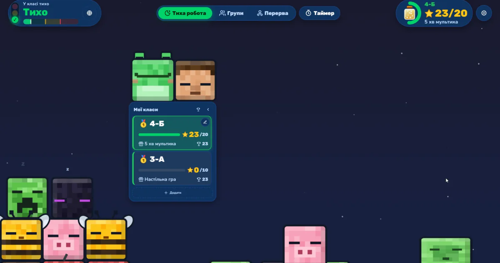

Коли в класі починається гамір, постійні зауваження швидко виснажують і вчителя, і дітей. Безкоштовний браузерний сервіс [«Тихий клас» (Bouncy)](https://sivochka.com/bouncy/) переносить контроль шуму на екран телевізора, проектора чи смарт-дошки. Він працює без реєстрації й без встановлення зайвих програм, а після першого відкриття запускається навіть без інтернету.

## Старт за одну хвилину перед дзвінком

Запустити сервіс можна на будь-якому комп'ютері з браузером і підключеним мікрофоном.

1. Відкрийте [sivochka.com/bouncy/](https://sivochka.com/bouncy/) на комп'ютері, підключеному до дошки, проектора чи телевізора.
2. Натисніть **«Почати урок»** і дозвольте браузеру доступ до мікрофона.
3. У вікні «Мої класи» оберіть свій клас або натисніть «+ Додати», щоб створити новий.
4. Попросіть дітей помовчати три секунди й натисніть кнопку з мішенню ◎ біля світлофора, щоб програма «запам'ятала тишу» саме вашого кабінету.
5. Натисніть **F**, щоб розгорнути вікно на весь екран.

Якщо у класі сонячно або проектор тьмяний, у налаштуваннях є перемикач «Світлий екран». А для запуску з робочого столу без відкриття браузера вручну працює кнопка «Встановити додаток на ПК».

## Як «Тихий клас» працює у трьох режимах і фоновій вкладці

Сервіс підлаштовується під тип завдання: один клік угорі або клавіші 1, 2, 3 змінюють суворість реакції на шум.

| Режим | Коли вмикати | Як реагує на звук і зірки |
|---|---|---|
| Тиха робота (1) | Самостійна, контрольна, читання | Найсуворіший: реагує навіть на голосний шепіт, зірки нараховуються |
| Групи (2) | Робота в парах і групах | Дозволяє говорити впівголоса, сигнал іде лише на гучні розмови, зірки нараховуються |
| Перерва (3) | Перерва, руханка, коротка пауза | Кульки підстрибують пропорційно до голосу, зірки не нараховуються |

Окремий плюс для вчителя: коли ви перемикаєтеся на презентацію або електронний журнал, сервіс не завмирає. У неактивній вкладці він продовжує слухати кабінет, рахувати зірки й вести таймер, а на самій вкладці браузера показує поточну зону («Тихо», «Шепіт» або «Шумно!»), залишок часу й кольорову крапку.

Якщо в класі стає занадто гучно, спрацьовує м'який звуковий сигнал. На вибір є 9 вбудованих варіантів («Тшшш», «Кришталь», «Скринька», «Сова», «Крапля», «Вдих-видих», «Радар», «Дзвоник», «Аркада») або режим «Без звуку». Перший сигнал звучить тихо (45% від обраної гучності) і поступово посилюється, лише якщо галас триває. Програма також ігнорує власні звуки з колонок, щоб не спрацьовувати на саму себе. За бажанням можна завантажити до 12 власних коротких аудіофайлів (MP3 або WAV, обрізаються до 5 секунд) і призначити окремий звук для конкретного класу.

## Банка зірок, вікно «Мої класи» і таймер завдання

Мотивація побудована так, щоб діти бачили прогрес одразу і не втрачали вже зароблене. За кожні 30, 60 або 90 секунд тиші (швидкість налаштовується окремо для кожного класу) у банку залітає зірка. Жовта зона ставить прогрес на паузу, а червона скидає лише поточну недозароблену зірку. **Уже зібрані зірки ніколи не забираються.** Після двох хвилин суцільної тиші з'являється «Серія тиші».

У перетягуваному вікні «Мої класи» можна вести кілька класів або гуртків одночасно: у кожного своя банка, ціль, вписаний приз (наприклад, 5 хвилин мультика чи гра наприкінці тижня) та історія отриманих нагород із датами. Кнопка рейтингу сортує класи за кількістю зірок за весь час і видає медалі першим трьом місцям. Самому вікну можна змінити місце на дошці, перетягнувши його мишкою чи пальцем.

Для обмежених у часі вправ угорі є кнопка **«Таймер»**: швидкий вибір на 1, 2, 3, 5, 10, 15 або 20 хвилин чи власний час до 90 хвилин. Великі цифри видно з останніх парт. Коли таймер добігає кінця, класу зараховується виконане завдання, а якщо весь цей час не було червоної зони, додається бонусна зірка.

## 13 тем персонажів, які читаються без слів

Настрій кульок на екрані показує стан класу миттєво: у тиші персонажі сплять, при шепоті прокидаються й підозріло дивляться, а в червоній зоні підстрибують і кричать. У меню «Кульки» доступно 13 тем: «Сплюшки» (за замовчуванням), «Крафт-Куби», «Блокс-Герої», «Бійці Арени», «Стихійці», «Капібари», «Смаколики», «Космос», «Бульбашки» (їх можна лопати дотиком на дошці), «Емоджі», «Глянець», «Числа» та «Очі». Там же регулюється кількість (від 10 до 150) і розмір (від 0.2× до 2.0×). Зміна теми не впливає на зірки й статистику, тому право обрати нову тему на тиждень легко зробити додатковим маленьким призом.

## Офлайн-робота і перенесення класів між кабінетами

Усі класи, зірки й налаштування зберігаються локально в браузері. Якщо ви працюєте в кількох кабінетах або змінюєте комп'ютер, відкрийте «Резервні копії та дані» і натисніть **«Зберегти файл»** — отримаєте `.json`-копію, яку на іншому ПК можна повернути за клік через «Відновити з файлу». Додатково сервіс автоматично зберігає останні 5 станів після важливих змін (додавання чи видалення класу, досягнення цілі, скидання банки), щоб випадковий клік не знищив прогрес.

Тим, кому цікава технічна сторона обробки звуку на віддалених шкільних вебкамерах, стане в пригоді попередня стаття про [створення шумоміра «Тихий клас»](https://sivochka.com/uk/blog/quiet-class-classroom-noise-meter/).

Відкрити й спробувати сервіс можна просто зараз на сторінці [«Тихий клас» (Bouncy)](https://sivochka.com/bouncy/). А якщо ви або батьки ваших учнів шукаєте індивідуальні онлайн-заняття зі Scratch, Python чи Unity, перегляньте умови на сторінці [репетиторства з програмування](https://sivochka.com/uk/tutoring/).
