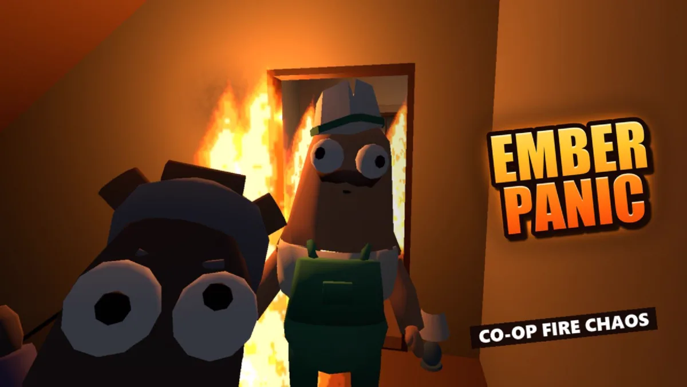

When RetroStyle Games announced the **Flame and Blame Dev Contest**, the prompt was simple and tempting: take inspiration from the *Flame and Blame* trailer and build a playable Unity demo. Nine days later, **Ember Panic** was born—a frantic first-person firefighting game you can play right in your browser.

  <a href="{{ '/games/ember-panic/' | relative_url }}" class="button button--primary" data-goatcounter-click="ember-panic-post-play-top">Play in browser →</a>

## Gameplay Video

Before stepping into the burning stairwell, watch the short gameplay video below. It shows the pace of a 3-minute shift, the extinguisher feel, panicking neighbours, and how fast a calm hallway turns into chaos.

  <button type="button" class="tutoring-video tutoring-video--facade" data-yt-src="https://www.youtube-nocookie.com/embed/rW22uImEDN8" data-yt-title="Ember Panic — gameplay trailer for the Flame and Blame Dev Contest" aria-label="Play Ember Panic video on YouTube">
    <svg viewBox="0 0 24 24" width="28" height="28" fill="currentColor"><path d="M8 5v14l11-7z"/></svg>
    {{ site.data[site.active_lang].strings.video_load_note }}
  </button>
  
<a class="text-link" href="https://youtu.be/rW22uImEDN8" target="_blank" rel="noopener noreferrer">Watch on YouTube ↗</a>

## UX and UI From the First Second

The main goal of a contest demo is to drop the player straight into the action without long tutorials or walls of text. You get three minutes, a burning four-storey apartment block in front of you, and a rescue van parked behind you.

I stripped the HUD down so every number is readable at a glance:

- the shift timer and building integrity bar at the top;
- saved and lost resident counters on the left;
- three tool slots at the bottom (`1` extinguisher, `2` axe, `3` defibrillator) plus the exact item value whenever you carry something;
- a clamped `VAN` marker that shows the distance to the rescue van even through smoke and walls.

You do not spend the first minute hunting for controls. You see fire, grab the extinguisher, hear a neighbour yell, and start improvising.



## Main Focus: The Residents

What hooked me most in the original *Flame and Blame* trailer was the NPC interaction, the look of burning buildings, and the fire extinguisher. That is why most of my energy in **Ember Panic** went into the residents.

They are not static ragdolls waiting to be carried from point A to point B. Every neighbour has distinct traits, voice lines, and reactions under stress. Normal residents try to help by dragging unconscious neighbours toward the street, while `Rager` and `Pyromaniac` traits break free from your grip, throw furniture, or accidentally ignite the next room.

Each resident also has a favorite item—Mr. Whiskers the cat, prosciutto, a skateboard, or a laptop. They worry about it while you carry them and keep shouting for it even from inside the rescue van. Delivering their favorite item adds `+100` bonus points to your score. And yes, the residents also have a few small secrets you only catch after a couple of runs.

## Fire and Consequences for the Whole Building

Even with the comedy chaos around the neighbours, this is a firefighting game first. Fire and extinguishing run on a shared live simulation rather than scripted visual effects.

Open doors let flames rush into the next room many times faster than closed ones. Close a door behind you and you buy precious seconds for a rescue. Smash a door open with the axe or leave it ajar, and the fire spreads across the floor, smoke thickens, and building integrity drops fast. Fall behind on extinguishing, and the whole block pays the price with a collapse finale.

## A Hidden Easter Egg (No Spoilers)

There is a hidden easter egg tucked inside **Ember Panic**. I will not spoil what it is, only how it works: you will not stumble into it by accident. Reaching it requires deliberately sacrificing something during your run. If you find it, let me know in the comments without giving away the answer.

## Play It and Tell Me What You Think

The build runs in any desktop browser with a keyboard and mouse. Jump in, try to save at least six residents, and share your thoughts in the comments on LinkedIn or under the YouTube video. I would love to hear what worked best, where you wanted even more chaos, and whether you found the easter egg.

  <a href="{{ '/games/ember-panic/' | relative_url }}" class="button button--primary" data-goatcounter-click="ember-panic-post-play-bottom">Play Ember Panic →</a>
  <a href="https://lnkd.in/p/dYkPzaqW" class="button button--secondary" target="_blank" rel="noopener noreferrer" data-goatcounter-click="ember-panic-post-linkedin">Discuss on LinkedIn ↗</a>

