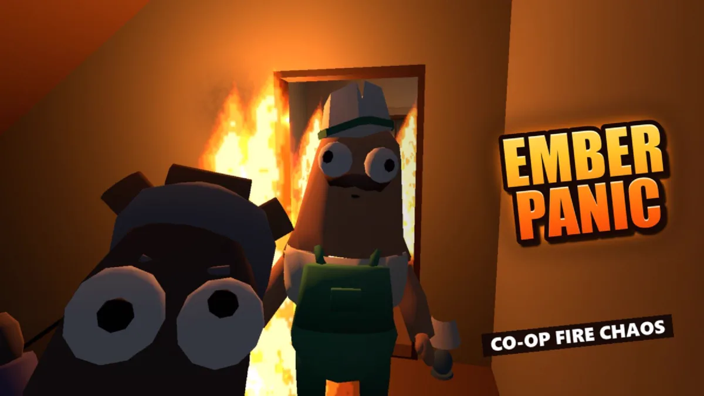

RetroStyle Games가 **Flame and Blame Dev Contest**를 열었을 때 주제는 단순하면서도 흥미로웠습니다. *Flame and Blame* 트레일러에서 영감을 받아 직접 플레이할 수 있는 Unity 데모를 만드는 것이었죠. 그렇게 9일 만에 브라우저에서 바로 즐길 수 있는 1인칭 소방 게임 **Ember Panic**이 탄생했습니다.

  <a href="{{ '/games/ember-panic/' | relative_url }}" class="button button--primary" data-goatcounter-click="ember-panic-post-play-top">브라우저에서 플레이하기 →</a>

## 게임플레이 영상

불타는 계단으로 뛰어들기 전에 짧은 게임플레이 영상을 먼저 확인해 보세요. 3분 교대 근무의 속도감, 소화기 조작감, 패닉에 빠진 이웃들의 반응까지 한눈에 볼 수 있습니다.

  <button type="button" class="tutoring-video tutoring-video--facade" data-yt-src="https://www.youtube-nocookie.com/embed/rW22uImEDN8" data-yt-title="Ember Panic — Flame and Blame Dev Contest 게임플레이 영상" aria-label="YouTube에서 Ember Panic 영상 재생">
    <svg viewBox="0 0 24 24" width="28" height="28" fill="currentColor"><path d="M8 5v14l11-7z"/></svg>
    {{ site.data[site.active_lang].strings.video_load_note }}
  </button>
  
<a class="text-link" href="https://youtu.be/rW22uImEDN8" target="_blank" rel="noopener noreferrer">YouTube에서 영상 보기 ↗</a>

## 첫 1초부터 직관적인 UX/UI

대회 데모의 핵심 목표는 긴 튜토리얼이나 설명문 없이 플레이어를 곧바로 상황 속으로 밀어 넣는 것이었습니다. 주어진 시간은 3분, 눈앞에는 불타는 4층 아파트가 있고 등 뒤에는 구조 밴이 대기하고 있습니다.

HUD는 한눈에 읽히도록 꼭 필요한 정보만 남겼습니다.

- 상단의 제한 시간과 건물 내구도 게이지
- 좌측의 구조 및 실종 주민 카운터
- 하단의 도구 슬롯 3개(`1` 소화기, `2` 도끼, `3` 제세동기)와 들고 있는 물건의 점수 표시
- 연기와 벽 너머로도 구조 밴의 거리를 알려 주는 `VAN` 마커

조작법을 찾느라 첫 1분을 허비할 필요가 없습니다. 불길을 보고 소화기를 집어 들고, 이웃의 비명을 듣는 순간 이미 게임에 빠져들게 됩니다.



## 가장 공들인 부분: 아파트 주민 NPC

원작 *Flame and Blame* 트레일러에서 가장 마음을 사로잡은 요소는 NPC와의 상호작용, 불타는 건물의 비주얼, 그리고 소화기였습니다. 그래서 **Ember Panic**에서는 주민 캐릭터에 가장 많은 시간을 쏟았습니다.

주민들은 단순히 A 지점에서 B 지점으로 옮기는 인형이 아닙니다. 각자 성격, 대사, 위기 상황에서의 행동 방식이 다릅니다. 일반 주민은 쓰러진 이웃을 거리 쪽으로 끌어내려 돕기도 하지만, `Rager`나 `Pyromaniac` 성향을 가진 주민은 손에서 빠져나가 가구를 집어 던지거나 옆방에 불을 옮기기도 합니다.

각 주민에게는 소중히 여기는 애장품(고양이 Mr. Whiskers, 프로슈토, 스케이트보드, 노트북)이 있습니다. 구조 밴 안에 들어간 뒤에도 애장품을 찾아달라고 소리치며, 이를 전달하면 `+100` 보너스 점수를 받습니다. 여러 번 플레이하다 보면 캐릭터들마다 숨겨 둔 작은 비밀도 발견하게 됩니다.

## 건물 전체에 영향을 주는 화재 시스템

주민들이 만들어 내는 코믹한 혼란 속에서도 이 게임의 본질은 소방입니다. 불과 진화는 단순한 연출이 아니라 하나의 실시간 시뮬레이션으로 작동합니다.

문이 열려 있으면 불길이 닫힌 문보다 훨씬 빠르게 옆방으로 번집니다. 지나온 문을 닫으면 구조할 시간을 벌 수 있지만, 도끼로 부수거나 열어 둔 채 두면 연기가 짙어지고 건물 내구도가 빠르게 떨어집니다. 진화가 늦어지면 결국 건물 전체가 붕괴하며 라운드가 끝납니다.

## 스포일러 없는 이스터에그 힌트

**Ember Panic** 안에는 숨겨진 이스터에그가 있습니다. 내용은 비밀로 두겠지만 한 가지 힌트만 드리자면, 그냥 지나가다 우연히 발견할 수는 없습니다. 이스터에그에 도달하려면 라운드 도중 무언가를 의도적으로 포기해야 합니다. 먼저 찾으셨다면 다른 분들을 위해 스포일러 없이 댓글로 알려 주세요.

## 직접 플레이하고 피드백을 들려주세요

데스크톱 브라우저에서 키보드와 마우스로 바로 플레이할 수 있습니다. 최소 6명의 주민을 구조해 보고, LinkedIn이나 YouTube 댓글로 소감을 남겨 주세요. 어떤 부분이 가장 재미있었는지, 어디서 더 큰 혼란이 있었으면 좋겠는지, 그리고 이스터에그를 찾으셨는지 궁금합니다.

  <a href="{{ '/games/ember-panic/' | relative_url }}" class="button button--primary" data-goatcounter-click="ember-panic-post-play-bottom">Ember Panic 플레이하기 →</a>
  <a href="https://lnkd.in/p/dYkPzaqW" class="button button--secondary" target="_blank" rel="noopener noreferrer" data-goatcounter-click="ember-panic-post-linkedin">LinkedIn에서 이야기하기 ↗</a>

