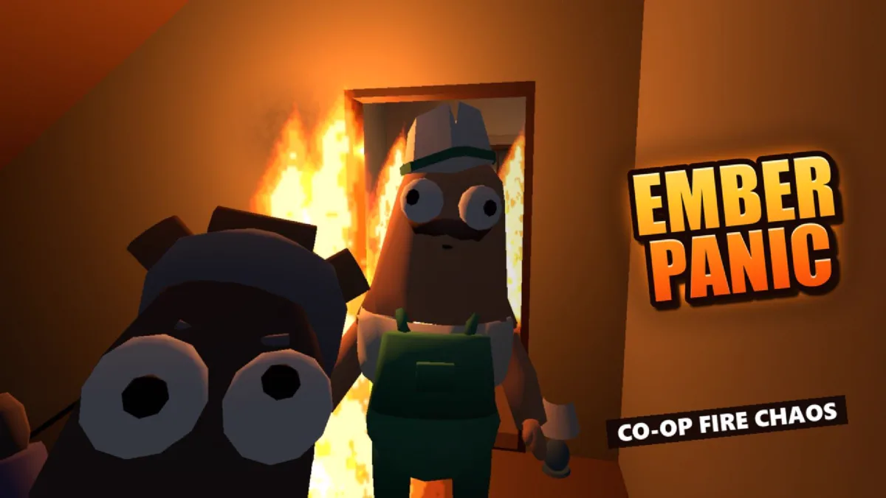

Kiedy studio RetroStyle Games ogłosiło konkurs **Flame and Blame Dev Contest**, zadanie było proste i kuszące: zainspirować się zwiastunem *Flame and Blame* i stworzyć grywalne demo w Unity. Dziewięć dni później powstało **Ember Panic** — zwariowana pierwszoosobowa gra strażacka, w którą można zagrać bezpośrednio w przeglądarce.

  <a href="{{ '/games/ember-panic/' | relative_url }}" class="button button--primary" data-goatcounter-click="ember-panic-post-play-top">Zagraj w przeglądarce →</a>

## Wideo z rozgrywki

Zanim wejdziesz na płonącą klatkę schodową, obejrzyj krótki film z rozgrywki poniżej. Pokazuje tempo 3-minutowej zmiany, działanie gaśnicy, panikujących sąsiadów oraz to, jak szybko spokojny korytarz zamienia się w chaos.

  <button type="button" class="tutoring-video tutoring-video--facade" data-yt-src="https://www.youtube-nocookie.com/embed/rW22uImEDN8" data-yt-title="Ember Panic — gameplay trailer for the Flame and Blame Dev Contest" aria-label="Odtwórz wideo Ember Panic na YouTube">
    <svg viewBox="0 0 24 24" width="28" height="28" fill="currentColor"><path d="M8 5v14l11-7z"/></svg>
    {{ site.data[site.active_lang].strings.video_load_note }}
  </button>
  
<a class="text-link" href="https://youtu.be/rW22uImEDN8" target="_blank" rel="noopener noreferrer">Obejrzyj na YouTube ↗</a>

## UX i UI od pierwszej sekundy

Głównym celem dema konkursowego jest wrzucenie gracza prosto w akcję bez długich samouczków i ścian tekstu. Masz trzy minuty, płonący czteropiętrowy blok przed sobą i furgonetkę ratunkową zaparkowaną za plecami.

Ograniczyłem HUD do minimum, tak aby każda liczba była czytelna na pierwszy rzut oka:

- licznik czasu zmiany i pasek stanu budynku u góry;
- liczniki uratowanych i utraconych mieszkańców po lewej;
- trzy sloty narzędzi na dole (`1` gaśnica, `2` siekiera, `3` defibrylator) oraz dokładna wartość przedmiotu, gdy coś niesiesz;
- przypięty znacznik `VAN`, który pokazuje odległość do furgonetki ratunkowej nawet przez dym i ściany.

Nie tracisz pierwszej minuty na szukanie sterowania. Widzisz ogień, łapiesz za gaśnicę, słyszysz krzyk sąsiada i zaczynasz improwizować.



## Główny punkt programu: mieszkańcy

To, co najbardziej przyciągnęło mnie w oryginalnym zwiastunie *Flame and Blame*, to interakcje z NPC, wygląd płonących budynków oraz gaśnica. Właśnie dlatego większość mojej energii w **Ember Panic** poszła w mieszkańców.

To nie są statyczne manekiny czekające na przeniesienie z punktu A do punktu B. Każdy sąsiad ma własne cechy, kwestie głosowe i reakcje pod wpływem stresu. Zwykli mieszkańcy próbują pomagać, wynosząc nieprzytomnych sąsiadów w stronę ulicy, natomiast cechy `Rager` i `Pyromaniac` wyrywają się z uścisku, rzucają meblami albo przypadkiem podpalają sąsiedni pokój.

Każdy mieszkaniec ma też ulubiony przedmiot — kota Mr. Whiskersa, prosciutto, deskorolkę albo laptopa. Martwią się o niego, gdy ich niesiesz, i wołają za nim nawet ze środka furgonetki ratunkowej. Dostarczenie ich ulubionego przedmiotu daje `+100` punktów bonusowych do wyniku. I tak, mieszkańcy mają też kilka drobnych sekretów, które wyłapiesz dopiero po paru podejściach.

## Ogień i konsekwencje dla całego budynku

Mimo komediowego chaosu wokół sąsiadów to przede wszystkim gra strażacka. Ogień i gaszenie działają na wspólnej symulacji na żywo, a nie na oskryptowanych efektach wizualnych.

Otwarte drzwi pozwalają płomieniom wedrzeć się do kolejnego pokoju wielokrotnie szybciej niż zamknięte. Zamknij drzwi za sobą, a kupisz cenne sekundy na akcję ratunkową. Wyważ drzwi siekierą albo zostaw je uchylone, a pożar rozleje się po piętrze, dym zgęstnieje i wytrzymałość budynku gwałtownie spadnie. Jeśli nie nadążysz z gaszeniem, cały blok zapłaci za to finałowym zawaleniem.

## Ukryty easter egg (bez spoilerów)

W **Ember Panic** schowany jest pewien easter egg. Nie zdradzę, czym jest, powiem tylko, jak działa: nie trafisz na niego przypadkiem. Dotarcie do niego wymaga celowego poświęcenia czegoś podczas swojej zmiany. Jeśli go znajdziesz, daj znać w komentarzach bez zdradzania rozwiązania.

## Zagraj i daj znać, co myślisz

Wersja przeglądarkowa działa w każdej desktopowej przeglądarce z klawiaturą i myszką. Wskocz do środka, spróbuj uratować co najmniej sześciu mieszkańców i podziel się wrażeniami w komentarzach na LinkedIn lub pod filmem na YouTube. Chętnie usłyszę, co zadziałało najlepiej, gdzie przydałoby się jeszcze więcej chaosu i czy udało się znaleźć easter egga.

  <a href="{{ '/games/ember-panic/' | relative_url }}" class="button button--primary" data-goatcounter-click="ember-panic-post-play-bottom">Zagraj w Ember Panic →</a>
  <a href="https://lnkd.in/p/dYkPzaqW" class="button button--secondary" target="_blank" rel="noopener noreferrer" data-goatcounter-click="ember-panic-post-linkedin">Podyskutuj na LinkedIn ↗</a>

