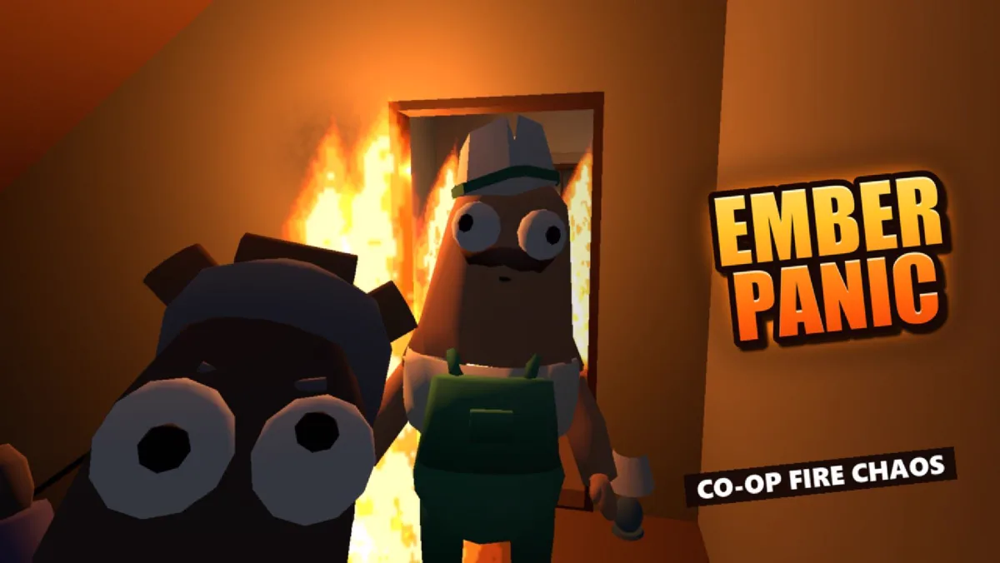

Когда RetroStyle Games объявили **Flame and Blame Dev Contest**, задача звучала просто и азартно: вдохновиться трейлером *Flame and Blame* и собрать собственную играбельную демку на Unity. Так за девять дней появилась **Ember Panic** — хаотичный симулятор пожарного от первого лица, в который можно сыграть прямо в браузере.

  <a href="{{ '/games/ember-panic/' | relative_url }}" class="button button--primary" data-goatcounter-click="ember-panic-post-play-top">Играть в браузере →</a>

## Видео с геймплеем

Перед тем как заходить в горящий подъезд, можно посмотреть короткий ролик: там хорошо виден темп раунда, работа огнетушителя, реакции соседей и то, как быстро хаос выходит из-под контроля.

  <button type="button" class="tutoring-video tutoring-video--facade" data-yt-src="https://www.youtube-nocookie.com/embed/rW22uImEDN8" data-yt-title="Ember Panic — геймплей конкурсной игры для Flame and Blame Dev Contest" aria-label="Воспроизвести видео Ember Panic на YouTube">
    <svg viewBox="0 0 24 24" width="28" height="28" fill="currentColor"><path d="M8 5v14l11-7z"/></svg>
    {{ site.data[site.active_lang].strings.video_load_note }}
  </button>
  
<a class="text-link" href="https://youtu.be/rW22uImEDN8" target="_blank" rel="noopener noreferrer">Открыть видео на YouTube ↗</a>

## UX/UI, который работает с первой секунды

Главная задача конкурсной демки — мгновенно погрузить игрока в геймплей без долгих туториалов и стен текста. У тебя три минуты, горящая четырехэтажка прямо перед глазами и спасательный фургон за спиной.

Я намеренно убрал всё лишнее из интерфейса, чтобы каждый элемент читался с первого взгляда:

- наверху таймер смены и полоска целостности здания;
- слева счетчик спасенных и потерянных жильцов;
- внизу три слота инструментов (`1` огнетушитель, `2` топор, `3` дефибриллятор) и подсказка ценности предмета в руках;
- маркер `VAN` показывает расстояние до фургона даже сквозь дым и стены.

Игрок не тратит первую минуту на поиск кнопок. Увидел пламя, схватил огнетушитель, услышал крик соседа и уже в деле.



## Главный фокус — жильцы дома

Когда я смотрел оригинальный трейлер *Flame and Blame*, больше всего зацепили три вещи: живое взаимодействие с НПС, визуал горящих зданий и сам огнетушитель. Поэтому в **Ember Panic** максимум внимания ушло именно на жильцов.

Это не статичные манекены, которых нужно перенести из точки А в точку Б. У каждого соседа свой характер, озвучка и поведение в панике. Обычные жильцы стараются помогать и тащат потерявших сознание к выходу, а персонажи с чертами `Rager` или `Pyromaniac` способны вырываться из рук, швырять мебель или случайно поджечь соседнюю комнату.

Отдельная история — их любимые вещи. У кого-то это кот Mr. Whiskers, у кого-то прошутто, скейтборд или ноутбук. Жильцы переживают за эти вещи и кричат о них даже из спасательного фургона. Доставка любимой вещи приносит дополнительные `+100` очков к итоговому счету. А еще у персонажей есть свои маленькие секретики, которые замечаешь не с первого забега.

## Огонь и последствия для всего здания

Несмотря на комедийный хаос с соседями, это прежде всего игра про пожарных. Огонь и тушение работают как единая живая симуляция, а не просто декоративный эффект.

Открытые двери пропускают пламя в соседнюю комнату в разы быстрее, чем закрытые. Закрыл дверь за собой — выиграл драгоценные секунды для эвакуации. Прорубил дверь топором или забыл ее прикрыть — огонь быстро пойдет по этажу, дым станет гуще, а целостность здания начнет таять на глазах. Если не успевать тушить, дом не прощает ошибок и раунд заканчивается обрушением.

## Пасхалка, за которую придется заплатить

В **Ember Panic** спрятана пасхалка. Спойлерить не буду, но подскажу принцип: просто так мимо нее не пройдешь. Чтобы до нее добраться, придется осознанно чем-то пожертвовать во время раунда. Если найдешь ее раньше остальных — напиши в комментариях, но без прямых подсказок.

## Поиграй и расскажи, как тебе

Игра работает в десктопном браузере (нужны клавиатура и мышь). Запускай демку, попробуй спасти хотя бы шестерых соседей и поделись впечатлениями в комментариях на LinkedIn или под видео на YouTube. Очень интересно, что зацепило больше всего, где хотелось бы еще больше хаоса и удалось ли найти ту самую пасхалку.

  <a href="{{ '/games/ember-panic/' | relative_url }}" class="button button--primary" data-goatcounter-click="ember-panic-post-play-bottom">Играть в Ember Panic →</a>
  <a href="https://lnkd.in/p/dYkPzaqW" class="button button--secondary" target="_blank" rel="noopener noreferrer" data-goatcounter-click="ember-panic-post-linkedin">Обсудить в LinkedIn ↗</a>

