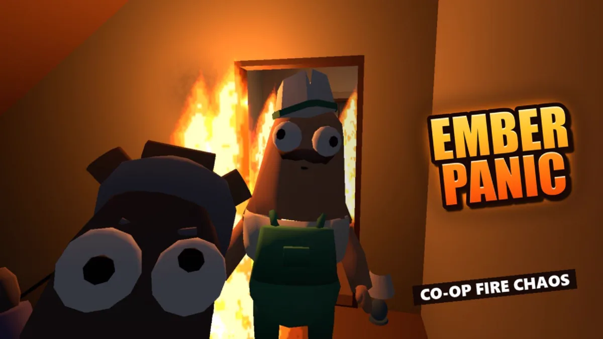

Коли RetroStyle Games оголосили **Flame and Blame Dev Contest**, завдання звучало просто і водночас азартно: взяти за натхнення трейлер *Flame and Blame* і зібрати власну іграбельну демку на Unity. Так за дев'ять днів з'явилася **Ember Panic** — хаотичний симулятор пожежника від першої особи, у який можна зіграти прямо у браузері.

  <a href="{{ '/games/ember-panic/' | relative_url }}" class="button button--primary" data-goatcounter-click="ember-panic-post-play-top">Пограти в браузері →</a>

## Відео з геймплеєм

Перед тим як заходити у палаючий під'їзд, можна глянути короткий ролик: там добре видно темп раунду, роботу вогнегасника, реакції сусідів і те, як швидко хаос виходить з-під контролю.

  <button type="button" class="tutoring-video tutoring-video--facade" data-yt-src="https://www.youtube-nocookie.com/embed/rW22uImEDN8" data-yt-title="Ember Panic — геймплей конкурсної гри для Flame and Blame Dev Contest" aria-label="Відтворити відео Ember Panic на YouTube">
    <svg viewBox="0 0 24 24" width="28" height="28" fill="currentColor"><path d="M8 5v14l11-7z"/></svg>
    {{ site.data[site.active_lang].strings.video_load_note }}
  </button>
  
<a class="text-link" href="https://youtu.be/rW22uImEDN8" target="_blank" rel="noopener noreferrer">Відкрити відео на YouTube ↗</a>

## UX/UI, який працює з першої секунди

Головна задача конкурсної демки — миттєво закинути гравця в ігрове середовище без довгих туторіалів і стін тексту. У тебе три хвилини, палаючий чотириповерховий будинок прямо перед очима й рятувальний фургон за спиною.

Я навмисно прибрав усе зайве з інтерфейсу, щоб кожен елемент читався периферійним зором:

- угорі таймер зміни та смужка цілісності будівлі;
- ліворуч лічильник врятованих і втрачених мешканців;
- унизу три слоти інструментів (`1` вогнегасник, `2` сокира, `3` дефібрилятор) і підказка цінності предмета, коли ти щось тримаєш у руках;
- маркер `VAN` підказує відстань до фургона навіть крізь дим і стіни.

Гравець не витрачає першу хвилину на пошук кнопок. Побачив полум'я, схопив вогнегасник, почув крик сусіда і вже в грі.



## Головний фокус — мешканці будинку

Коли я дивився оригінальний трейлер *Flame and Blame*, найбільше зачепили три речі: жива взаємодія з НПС, візуал будівель у вогні та сам вогнегасник. Тому в **Ember Panic** найбільше уваги пішло саме на мешканців.

Це не просто статичні манекени, яких треба перенести з точки А в точку Б. У кожного сусіда є власний характер, озвучка й поведінка під час паніки. Хтось намагається допомагати й тягне непритомних до виходу, а хтось із характером `Rager` або `Pyromaniac` здатний вириватися з рук, жбурляти меблі чи ненароком підпалити сусідню кімнату.

Окрема історія — їхні улюблені речі. У когось це кіт Mr. Whiskers, у когось прошуто, скейтборд або ноутбук. Мешканці переживають за ці речі й нагадують про них навіть тоді, коли ти вже дотягнув їх до фургона. Доставка улюбленої речі дає додаткові `+100` очок до фінального рахунку. А ще в персонажів є свої маленькі секретики, які помічаєш не з першого забігу.

## Вогонь і наслідки для всієї будівлі

Попри комедійний хаос із сусідами, це передусім гра про пожежників. Вогонь і гасіння працюють тут як єдина симуляція, а не як декорація на фоні.

Відчинені двері пропускають полум'я в сусідню кімнату в рази швидше, ніж зачинені. Зачинив двері за собою — виграв дорогоцінні секунди для евакуації. Прорубав двері сокирою або забув їх прикрити — вогонь швидко піде поверхом далі, дим стане густішим, а цілісність будівлі почне танути на очах. Якщо затягнути з гасінням, будинок не пробачає помилок і раунд закінчується обвалом.

## Пасхалка, за яку доведеться заплатити

У **Ember Panic** захована пасхалка. Спойлерити не буду, але підкажу принцип: просто так повз неї не пройдеш. Щоб дістатися до неї, доведеться свідомо чимось пожертвувати під час раунду. Якщо знайдеш її раніше за інших — напиши в коментарях, але без прямих підказок для решти.

## Пограй і розкажи, як тобі

Гра працює у десктопному браузері (потрібні клавіатура й миша). Запускай демку, спробуй врятувати хоча б шістьох сусідів і поділися враженнями в коментарях на LinkedIn або під відео на YouTube. Мені дуже цікаво, що зачепило найбільше, де хотілося б більше хаосу і чи вдалося знайти ту саму пасхалку.

  <a href="{{ '/games/ember-panic/' | relative_url }}" class="button button--primary" data-goatcounter-click="ember-panic-post-play-bottom">Пограти в Ember Panic →</a>
  <a href="https://lnkd.in/p/dYkPzaqW" class="button button--secondary" target="_blank" rel="noopener noreferrer" data-goatcounter-click="ember-panic-post-linkedin">Обговорити в LinkedIn ↗</a>

